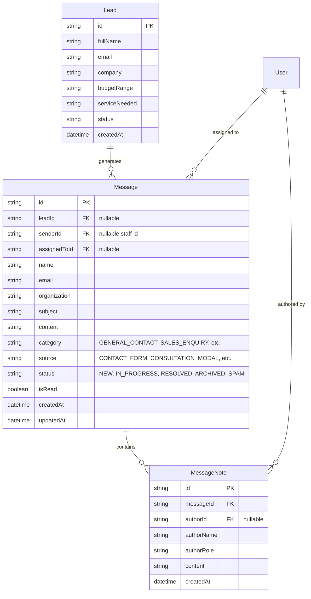

# VarunyaTech Admin Messages & Inbox Module Specification

## 1. System Overview

The **Admin Messages & Inbox Module** provides authorized VarunyaTech team members (Admins, Managers, Sales Representatives) with a centralized command center to view, triage, track, and manage all incoming communications from website visitors.

The module bridges public customer inquiry surfaces (such as the Contact Form, Consultation Modal, and Lead Ingestion APIs) directly with an internal inbox without duplicating CRM records or exposing private staff metadata.

---

## 2. Inbound Communication Sources

Visitor communications are ingested and persisted into the inbox through multiple channels:

1. **Main Contact Form (`/contact`)**:
   - Captures: `name`, `email`, `organization`, `serviceNeeded`, `budgetRange`, `message`.
   - Ingestion Endpoint: `POST /api/v1/leads`.
   - Generates both a CRM `Lead` and a linked inbox `Message` inside an atomic `prisma.$transaction`.
2. **Consultation Modal (`components/ui/Modal.tsx`)**:
   - Captures: Consultation booking details, proposed timeline, project scope.
   - Ingestion: Persisted with category `CONSULTATION`.
3. **Direct Messages API (`POST /api/v1/messages`)**:
   - Public submission endpoint with rate-limiting, strict email validation, and sanitization.
   - Categorizes incoming inquiries into:
     - `GENERAL_CONTACT`: General queries and partnership questions.
     - `SALES_ENQUIRY`: Project inquiries, RFPs, and scope specifications.
     - `CONSULTATION`: Technical consultation and architecture reviews.
     - `SUPPORT_TICKET`: Technical assistance and portal support.

---

## 3. Database Architecture & Relations

The data model is defined in `prisma/schema.prisma` and supports both SQLite (local development) and PostgreSQL (production / staging):



### Key Schema Characteristics:
- **Zero-Loss Decoupling**: If an inquiry comes in without an existing lead, a message is still preserved; if a lead already exists, the message is linked via `leadId`.
- **Indexed for Real-Time Querying**:
  - `@@index([createdAt])` for chronological feeds.
  - `@@index([isRead])` for high-performance unread counts.
  - `@@index([status])` for workflow filtration.
  - `@@index([email])` for customer history lookup.
  - `@@index([leadId])` for CRM cross-referencing.
- **Strict Privacy**: `MessageNote` records are internal-only and never exposed to public endpoints or client inquiries.

---

## 4. API Endpoints & Role-Based Access Control (RBAC)

All admin routes enforce server-side session authentication via `lib/auth/admin-auth.ts`:
- Supported authorization tokens: `X-Staff-Token` or `Authorization: Bearer <token>`.
- Authorized roles: `ADMIN`, `SUPER_ADMIN`, `MANAGER`, `SALES`.
- Invalidation / denial: Unauthorized or missing credentials immediately return `401 Unauthorized` or `403 Forbidden`.

### Endpoint Directory

| Endpoint | Method | Access | Description |
| :--- | :--- | :--- | :--- |
| `/api/v1/leads` | `POST` | Public (Rate-limited) | Submits visitor enquiry; atomically creates `Lead` and inbox `Message`. |
| `/api/v1/leads` | `GET` | Staff Only (RBAC) | Lists leads with filtering and search. |
| `/api/v1/leads/[id]` | `GET` | Staff Only (RBAC) | Retrieves lead details with linked inbox messages. |
| `/api/v1/messages` | `GET` | Staff Only (RBAC) | In-depth search, filtering (`ALL`, `UNREAD`, `READ`, `NEW`, `IN_PROGRESS`, `RESOLVED`, `ARCHIVED`, `SPAM`), source filter, category filter, sorting (`newest`, `oldest`, `status`), pagination, and total/unread counts. |
| `/api/v1/messages` | `POST` | Public (Rate-limited) | Public direct inquiry submission. |
| `/api/v1/messages/unread-count` | `GET` | Staff Only (RBAC) | Lightweight endpoint polled by admin navigation badge. |
| `/api/v1/messages/[id]` | `GET` | Staff Only (RBAC) | Fetches complete message detail, linked lead, and internal notes. |
| `/api/v1/messages/[id]` | `PATCH` | Staff Only (RBAC) | Updates read status, workflow status, or assignment; records audit log. |
| `/api/v1/messages/[id]` | `DELETE` | Staff Only (`ADMIN`, `MANAGER`) | Archives message or performs soft deletion. |
| `/api/v1/messages/[id]/notes` | `GET` | Staff Only (RBAC) | Retrieves internal confidential staff notes. |
| `/api/v1/messages/[id]/notes` | `POST` | Staff Only (RBAC) | Appends internal confidential note authored by the active staff member. |

---

## 5. Staff Message-Management Workflow

1. **Discovery & Triage**:
   - Staff members see a real-time unread badge next to **Messages & Inbox** in the admin sidebar.
   - Filter by status tabs: `All`, `Unread`, `New`, `In Progress`, `Resolved`, `Archived`, `Spam`.
   - Real-time instant search by sender name, email, subject, or message content.
2. **Reading & Reviewing**:
   - Selecting a message highlights it in the feed and loads the detail pane.
   - Automatically marks the message as `Read` (`PATCH isRead: true`).
   - Displays sender details (name, email, company/organization, submission time, source badge, category badge).
   - Shows associated CRM Lead status with a direct jump link to `/admin/crm?id=...`.
3. **Collaboration & Notes**:
   - Staff can add confidential internal notes to discuss project viability, technical feasibility, or pricing considerations.
   - Notes display staff author name, role, and exact timestamp.
4. **Follow-up & Communication**:
   - **One-Click Copy**: Copy visitor's email address safely.
   - **Safe Mail Client Link**: Click `Reply via Email` to launch the native mail client (`mailto:`) pre-filled with the subject reference `Re: [Subject]`.
   - Prevents fake email delivery claims by delegating actual transmission to verified client mail agents until a dedicated outbound SMTP/SES provider is configured.
5. **Resolution & Archival**:
   - Mark status as `IN_PROGRESS`, `RESOLVED`, `ARCHIVED`, or flag as `SPAM`.
   - Destructive action confirmation dialog protects against accidental deletion.

---

## 6. Migration and Rollback Procedures

### Local Development (SQLite):
```bash
npx prisma generate
npx prisma db push
```

### Staging / Production Deployment (PostgreSQL):
1. **Validation**:
   Ensure `DATABASE_URL` is set to the isolated target database.
2. **Schema Synchronization**:
   ```bash
   npx prisma db push --accept-data-loss=false
   ```
3. **Container Rebuild**:
   ```bash
   docker compose build app
   docker compose up -d app
   ```
4. **Rollback Procedure**:
   If rollback is required:
   - Revert commit `git revert <commit-hash>`.
   - Restore database backup taken prior to deployment.
   - Restart previous container image.

---

## 7. Known Issues & Upstream Resolutions

- **Blog Detail Route (`/blog/[slug]`)**:
  - *Identified Issue*: Next.js 14 App Router passed `params` as a synchronous object, triggering `An unsupported type was passed to use(): [object Object]`.
  - *Resolution*: Updated `app/blog/[slug]/page.tsx` to safely handle both Promise and object instances of `params` across React Server Component runtime variations.
